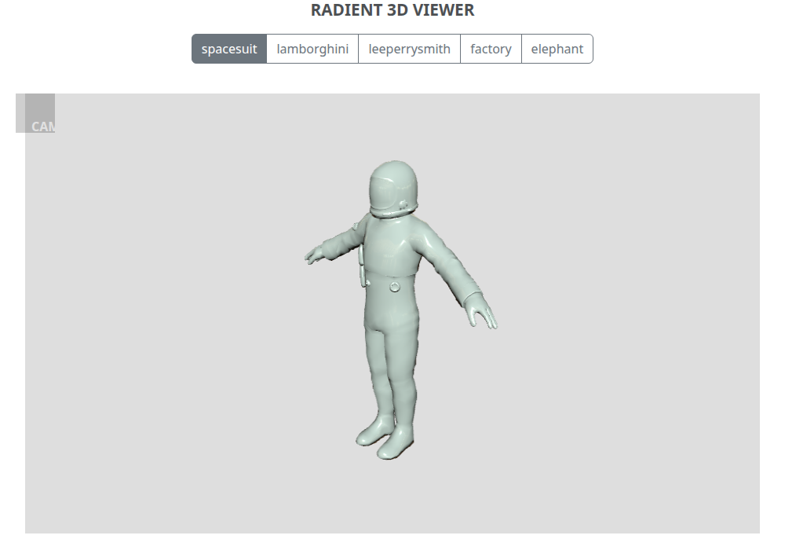

# radient-3d-viewer-django

A small three.js viewer for 3D models in the browser, hosted by a Django 5.2 app. Five sample models ship
with the repo; the camera, light, model position and colour are adjustable. This is the Django sibling of
[`radient-3d-viewer`](https://github.com/seetadev/radient-3d-viewer) (Tornado) and shares its frontend.



## Contents
[Requirements](#requirements) · [Setup & run](#setup--run) · [Configuration](#configuration) · [Test](#test) ·
[Docker](#docker) · [Deploy (production)](#deploy-production-behind-a-tls-proxy) ·
[Models, frontend and the sync workflow](#models-frontend-and-the-sync-workflow) · [Architecture](#architecture) ·
[Known issues](#known-issues)

## Requirements
| For | Needs |
|---|---|
| Running the server | **Python 3.12+** (Django 5.2 LTS; CI tests 3.12, 3.13 and 3.14) |
| Browser tests | Node 22 (only for the Playwright tests, not for running the app) |
| Docker | Docker with Compose v2 |

## Setup & run
```bash
python -m venv .venv && source .venv/bin/activate
pip install -r requirements.txt
export DJANGO_SECRET_KEY="$(python -c 'import secrets; print(secrets.token_urlsafe(50))')"
export DJANGO_DEBUG=1                  # development only
python manage.py runserver
```
Open <http://localhost:8000>. The app has no models of its own, so there is nothing to migrate
(`runserver` may mention unapplied built-in migrations; they are not used). The app **refuses to start
without `DJANGO_SECRET_KEY`**, and, unless `DJANGO_DEBUG=1`, without `DJANGO_ALLOWED_HOSTS`.

Hover over the **CAM** box (top left) for the controls: camera distance / height / angle, light position, model
position buttons and the colour picker; the buttons on top switch between the five models.

## Configuration
Everything is read from the environment (see `.env.example`). `manage.py` does **not** load `.env` files: export the
variables, or use `docker compose`, which reads `.env`.

| Variable | Default | Meaning |
|---|---|---|
| `DJANGO_SECRET_KEY` | **required** | Blank is refused. The key that used to be hardcoded in this repo is public in the git history; treat it as compromised and never reuse it |
| `DJANGO_ALLOWED_HOSTS` | **required** unless `DJANGO_DEBUG=1` | Comma-separated host names, e.g. `viewer.example.org`. No wildcard default |
| `DJANGO_DEBUG` | off | `1` = development: debug on, `localhost`/`127.0.0.1`/`[::1]` allowed, no HTTPS enforcement |
| `DJANGO_HTTPS_ONLY` | **on** when `DJANGO_DEBUG` is off | HTTPS redirect + `Secure` session/CSRF cookies. Set `0` **only** to try the production image over plain `http://localhost` |
| `DJANGO_TRUST_PROXY_SSL` | off | `1` = trust the proxy's `X-Forwarded-Proto` header to know a request was HTTPS (needed behind a TLS-terminating proxy) |
| `DJANGO_HSTS_SECONDS` | off | `Strict-Transport-Security: max-age=<n>`. See the warning in [Deploy](#deploy-production-behind-a-tls-proxy) |
| `DJANGO_HSTS_INCLUDE_SUBDOMAINS` | off | Adds `includeSubDomains` (only with `DJANGO_HSTS_SECONDS`). `preload` is never enabled |
| `PORT`, `HOST_PORT` | 8000 | Docker: port inside the container / port published on the host |

The app also sends a strict Content-Security-Policy (a per-request nonce for the single inline script),
`X-Frame-Options: DENY`, `nosniff`, `Referrer-Policy: no-referrer` and `Cross-Origin-Opener-Policy: same-origin`.
`python manage.py check --deploy --fail-level WARNING` is clean (CI enforces it).

## Test
```bash
pip install -r requirements-dev.txt
pytest          # views, security settings/headers/CSP, static serving + path traversal, WhiteNoise

npm ci
npx playwright install chromium            # once
npx playwright test                        # starts runserver itself; renders all 5 models, drives the controls
```
The browser tests fail on any failed request or page error (including CSP violations). Use
`PYTHON=.venv/bin/python npx playwright test` if `python` is not the interpreter you want. CI
(`.github/workflows/ci.yml`) runs: pytest on Python 3.12/3.13/3.14 (plus `check -W error`,
`makemigrations --check` and `check --deploy`), the browser flow, the same flow against the Docker container, and
`pip-audit` + `npm audit`.

## Docker
```bash
export DJANGO_SECRET_KEY="$(python -c 'import secrets; print(secrets.token_urlsafe(50))')"
docker compose up --build            # http://localhost:8000
```
Compose refuses to start without `DJANGO_SECRET_KEY`. Multi-stage image: a Node stage minifies the browser JS,
then `python:3.13-slim` runs **gunicorn** as a **non-root** user (uid 10001) with a healthcheck; **WhiteNoise**
serves the `collectstatic` output, precompressed (gzip). Compose adds a read-only root filesystem,
`cap_drop: ALL` and `no-new-privileges`. `docker-compose.yml` defaults `DJANGO_HTTPS_ONLY=0` so the image works on plain
`http://localhost`; **do not use that default in production.**

## Deploy (production, behind a TLS proxy)
Run the image behind a reverse proxy / load balancer that terminates TLS (nginx, Caddy, an AWS ALB, ...).

1. Set `DJANGO_SECRET_KEY` (new, random) and `DJANGO_ALLOWED_HOSTS=<your host names>`. Do **not** set `DJANGO_DEBUG`.
2. **Keep HTTPS-only on: `DJANGO_HTTPS_ONLY=1`** (it is the default when debug is off, but set it explicitly in your
   compose/.env so it cannot be lost). Django then redirects HTTP to HTTPS and marks session and CSRF cookies `Secure`.
3. **Set `DJANGO_TRUST_PROXY_SSL=1` and make the proxy set `X-Forwarded-Proto` (overwriting any client-sent value).**
   Without it Django cannot tell the request was already HTTPS and **redirects in a loop**. Only enable this when
   the container port is reachable *only* from the proxy, otherwise clients could spoof the header.
4. **HSTS is opt-in because it cannot be undone remotely.** Browsers remember it for `max-age`. Leave
   `DJANGO_HSTS_SECONDS` unset unless the *whole* host is HTTPS only; if you enable it, start small
   (`DJANGO_HSTS_SECONDS=3600`) and raise it later. `DJANGO_HSTS_INCLUDE_SUBDOMAINS=1` forces https on **every
   subdomain** for that period, so never set it if any subdomain is plain HTTP; deployments reached by bare IP (for example
   EC2) should leave HSTS off. `preload` is never enabled. The HTTPS redirect and secure cookies (reversible) stay on either way.
5. Verify with `python manage.py check --deploy --fail-level WARNING` using your production environment.

```bash
# example .env for production behind a TLS proxy (HSTS deliberately short, no subdomains)
DJANGO_SECRET_KEY=<generated>
DJANGO_ALLOWED_HOSTS=viewer.example.org
DJANGO_HTTPS_ONLY=1
DJANGO_TRUST_PROXY_SSL=1
DJANGO_HSTS_SECONDS=3600
```

## Models, frontend and the sync workflow
The viewer frontend (`app/static/app.js`), the vendored three.js 0.187.0 / Bootstrap 5.3.8 CSS
(`app/static/vendor/`) and the GLB models (`app/static/models/*.glb`) are **copied, not forked**, from
`radient-3d-viewer`, which is their source of truth: that repo holds the original JSON models, the reproducible
JSON-to-GLB converter and the npm vendoring script. `app/static/models/PROVENANCE.md` records the source commit.
To update after changing anything there:
```bash
# in radient-3d-viewer: python tools/convert_legacy_models.py   and/or   npm ci && npm run vendor
tools/sync-frontend.sh ../radient-3d-viewer     # copies app.js, vendor/, *.glb and tools/minify.mjs
```
To add a model: add it in `radient-3d-viewer` (see its README), sync, then add its button to
`app/templates/app/index.html` and its name to the model lists in `app/tests.py`, `tests/test_static.py` and
`tests/e2e/viewer.spec.mjs`. Do not edit the synced files by hand here.

## Architecture
```
browser ── GET / ───────► Django (Radient_Django, app)
   │                        ├─ SecurityMiddleware → CSPMiddleware (per-request nonce) → WhiteNoise → ...
   │                        ├─ /            app.views.home → app/index.html (, import map)
   │                        └─ /static/...  app.js, vendor/three, models/*.glb, cubemap  (WhiteNoise / runserver)
   └─ app.js (ES module): GLTFLoader → merge primitives → smooth normals → one MeshStandardMaterial + cubemap
```
| Path | What |
|---|---|
| `Radient_Django/` | settings (env-driven), urls, wsgi, `test_settings.py` |
| `app/` | `views.py` (home), `middleware.py` (CSP), template, static files, `tests.py` |
| `tests/` | pytest suites and the Playwright spec |
| `tools/` | `sync-frontend.sh`, `minify.mjs` (Docker build only; rewrites files in place) |

## Known issues
* The spacesuit's original textures (`Spacesuit_{Body,Glove,Helmet}_D.tga`) were never committed; the viewer also shades
  every model with one material (see the sibling repo).
* Lighting is smoother than the old three.js r75 renderer (physically based lights).
* The contact/about/login routes were removed (their templates never existed); there are no user accounts.
